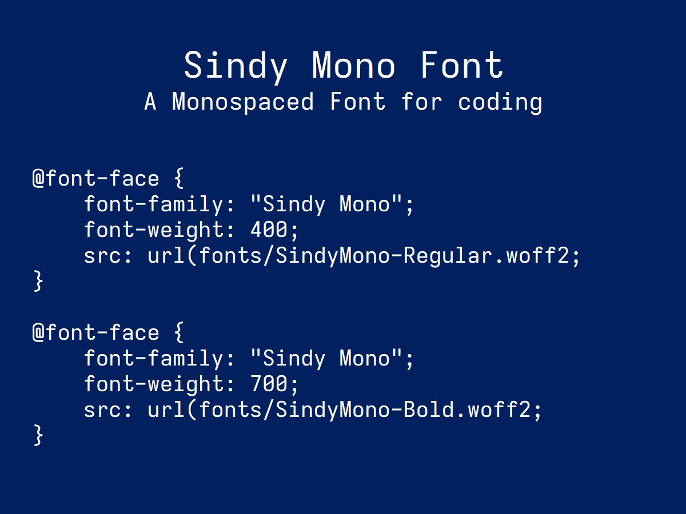

# Sindy Mono font family
Sindy Mono font is a new monospaced font family based from Iosevka with a inspiration from the Inter font made by Rasmus Anderson. Sindy Mono is a remake of the Sindy Code font from FontStruct, featuring fewer serifs to make a cleaner look.

Before the Sindy Mono fonts are exists, many people prefers the JetBrains Mono font for code snippets while the rest of website/app mainly using Inter font. Apart from JetBrains Mono, there's also a monospaced font called "Paper Mono" that is really similar to SF Mono (San Francisco) font winch is the monospaced sibling of the SF Pro font. However, there's almost no fonts that can be exactly similar to Inter font as these three monospaced fonts that mentioned here uses opened digit "4", opened/diagonal digit "6", and opened/diagonal digit "9".

The Sindy Mono font project was begun in FontStruct as "Indomalay Code" at 23 December 2025 with the inspiration from Inter font, and previously only support basic latin languages. In 1 May 2026, the font finally got a major update with new more glyphs, and the font is now renamed to "Sindy Code". Sindy Code font is a monospaced font that is designed to match the most its letterforms with the Inter font, making it perfect to be paired even though it needs some letterform adjustments to make it good at monospaced width.

In 24 August 2026, I decided to remove the Sindy Code font from FontStruct due to lack of scale and the OpenType feature of the font itself. But still on the same day, I decided to also remake the Sindy Code font as "Sindy Mono" in GitHub, a monospaced font based from Iosevka with Inter-liked letterforms.

## Characteristics
Sindy Mono font uses closed contours in both digit "6" and "9", and also uses closed-form digit "4". Just like other monospaced fonts, the digit "1" is has bottom base to fill up the empty gap. Some letters has extra serifs for uppercase "I", uppercase "J", lowercase "i", lowercase "j", and lowercase "l". Since the font does only use necessary serifs to fill empty gaps, most other characters and letters like "f" and "r" does not have serifs anymore to maintain its clean design. Sindy Mono font also features true italics rather than slanted oblique to enhance the horizontal flow for the eyes, winch also makes the italics looks more friendly and warm at same time.

## Styles
Sindy Mono font contains 18 variants in total, including 9 weights (from **Thin** to **Black**) and *True Italics* at every weight.

## License
Sindy Mono fonts are licensed under SIL Open Font License 1.1

You're allowed to use this font for personal or commercial projects, this license applies to all Sindy Mono font files.
